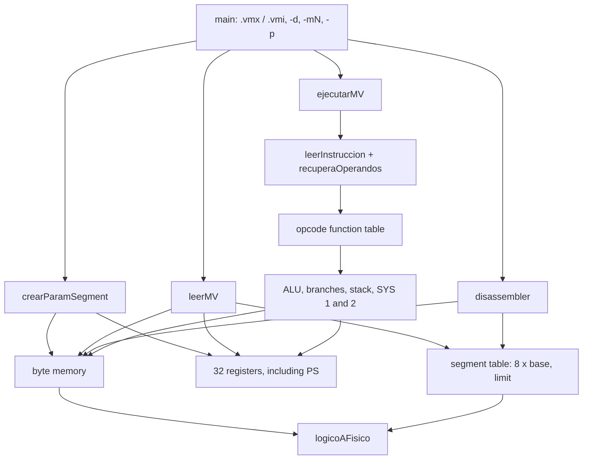

# VMX25 virtual machine

Teaching virtual machine for the Computer Architecture course (2025), written in C by Nicolás Iavicoli Dulcet with Eugenia and CamiSerafini. It loads a `VMX25` memory image, builds a 32-register machine with a segmented byte memory, optionally prints a disassembly, and then interprets the instruction stream.

The sources compile with GCC. On the images shipped in this tree, the version-1 loader rejects the file before the first instruction runs. The [run section](#run) shows that transcript and why the size check fires.

## What the program implements

### Machine state

`maquinaVirtual` in `mv/include/mv.h` holds:

- a byte array, 16384 bytes by default (`MAX_MEM`), replaced when `-m` is passed
- 32 registers of 32 bits (`MAX_REG`)
- a segment table of 8 entries (`MAX_SEG`), each a base and a limit

Named registers, with the index used throughout the sources and the disassembler's name table:

| Index | Name | Role in this code |
| ---: | --- | --- |
| 0 | LAR | Logical address of the last memory read |
| 1 | MAR | Last memory read: size in the high 16 bits, physical address in the low 16 |
| 2 | MBR | Value returned by the last memory read |
| 3 | IP | Instruction pointer. Low 16 bits are the offset. `logicoAFisico` takes the segment index from bits 16–23 |
| 4 | OPC | Opcode of the instruction just fetched |
| 5–6 | OP1, OP2 | Encoded operand descriptors |
| 7 | SP | Stack pointer used by PUSH, POP, CALL, and RET |
| 8 | BP | Named in the register table; no instruction reads or writes it |
| 10–15 | EAX, EBX, ECX, EDX, EEX, EFX | General-purpose registers |
| 16 | AC | Written by DIV |
| 17 | CC | Condition code written by `setCC` |
| 26–31 | CS, DS, ES, SS, KS, PS | Segment registers. Version 1 stores a table index in the high half (`CS = 0`, `DS = 0x00010000`). Version 2 stores `physicalBase << 16` |
| 9, 18–25 | — | Present in the array, unnamed in the disassembler |

A logical address uses bits 0–15 as the offset and bits 16–23 as the segment-table index (`logicoAFisico`). The physical address is `base + offset`. A segment index of 8 or more, or an offset outside `0 .. limit-1`, prints an error and exits.

### Instruction word

The first byte of an instruction is split the same way in `leerInstruccion` and in the disassembler:

- bits 0–4 (`byte & 0x1F`): opcode
- bits 4–5 (`(byte >> 4) & 0x03`): type of operand A
- bits 6–7 (`(byte >> 6) & 0x03`): type of operand B

Bit 4 belongs to both the opcode mask and operand A's type. Operand bytes follow the opcode, B first and then A. The type code is also the payload length:

| Type | Bytes | Meaning |
| ---: | ---: | --- |
| 0 | 0 | Operand absent |
| 1 | 1 | Register. Low 5 bits are the register index. Bits 6–7 select a slice: 0 the full 32 bits, 1 the low byte, 2 the high byte, 3 the low 16 bits |
| 2 | 2 | Immediate |
| 3 | 3 | Memory: one register byte, then a 16-bit displacement |

The disassembler reads immediates and displacements as big-endian. `recuperaOperandos` ORs the two bytes with no shift. The opcode byte is read through `logicoAFisico`; the operand bytes are read with the logical IP as a raw memory index. Those two addresses match while the code segment sits at physical 0 and IP's segment index is 0, which is how the version-1 loader sets up CS.

`ejecutarMV` advances IP by `1 + typeA + typeB` before the operation runs, then calls the function pointer for that opcode. After each instruction it prints EAX, EBX, ECX, and EDX and waits for Enter (`scanf("%*c")`). The loop continues while IP is greater than or equal to 0 and strictly less than the limit stored in segment-table entry 0. `STOP` calls `exit(0)`, so `main` does not reach its final printf when a program stops that way.

`getOp` / `setOp` recover a value from the descriptor stored in OP1 or OP2 (type in the top byte). Register ids on that path are masked with `op & 0x05` inside `getReg`. A memory read sign-extends when bit 15 of the loaded value is set, including after a 4-byte read, and it updates LAR, MAR, and MBR. `setMAR` always records a size of 4. A memory write stores one byte at the index `getMem` just returned.

### Instruction set

Opcodes below are the values installed in `cargaVF` and the disassembler's mnemonic table. `0x09` and `0x0A` have neither. Two-operand operations use operand A as the destination and operand B as the source. SHL, SAR, and RND write operand B.

| Opcode | Mnemonic | What the function does |
| --- | --- | --- |
| `0x00` | SYS | System call. The operand value 1 calls `readSys` and 2 calls `writeSys`. Any other number aborts. |
| `0x01` | JMP | IP becomes the operand. |
| `0x02` | JZ | Jump if `CC == 0`. |
| `0x03` | JP | Jump if `CC > 0`. |
| `0x04` | JN | Jump if `CC < 0`. |
| `0x05` | JNZ | Jump if `CC != 0`. |
| `0x06` | JNP | Jump if `CC >= 0`. |
| `0x07` | JNN | Jump if `CC <= 0`. |
| `0x08` | NOT | Bitwise complement of the operand. |
| `0x0B` | PUSH | Pushes the operand as 4 bytes and subtracts 4 from SP. Marked unfinished in the source. |
| `0x0C` | POP | Pops 4 bytes into the operand and adds 4 to SP. Marked unfinished in the source. |
| `0x0D` | CALL | Saves IP as 4 bytes and jumps to the operand. Marked unfinished in the source. |
| `0x0E` | RET | Loads IP from the stack and adds 4 to SP. Marked unfinished in the source. |
| `0x0F` | STOP | `exit(0)`. |
| `0x10` | MOV | Destination = source. |
| `0x11` | ADD | Destination += source. CC is set from the destination. |
| `0x12` | SUB | Destination -= source. CC is set from the destination. |
| `0x13` | MUL | Destination *= source. CC is set from the source. |
| `0x14` | DIV | Integer quotient in the destination. AC is then set to that destination modulo the source. A zero source aborts. CC is set from the destination. |
| `0x15` | CMP | CC is set from source − destination. The destination is left unchanged. |
| `0x16` | SHL | Source = source shifted left by the destination. CC is set from the source. |
| `0x17` | SHR | Destination = destination shifted right, as an unsigned value, by the source. CC is set from the destination. |
| `0x18` | SAR | Source = destination shifted right, with the signed `>>` of `int`, by the source. CC is set from the destination. |
| `0x19` | AND | Destination &= source. CC is set from the destination. |
| `0x1A` | OR | Destination \|= source. CC is set from the destination. |
| `0x1B` | XOR | Destination ^= source. CC is set from the destination. |
| `0x1C` | SWAP | Exchanges the two operands. |
| `0x1D` | LDL | Low 16 bits of the destination become the low 16 bits of the source. |
| `0x1E` | LDH | High 16 bits of the destination become the low 16 bits of the source. The low 16 bits of the destination are cleared. |
| `0x1F` | RND | Second operand = `rand()`. Nothing in the program calls `srand`. |

`setCC` stores `0` when the result is positive, `0x4000` (bit 14) when it is zero, and `0x8000` (bit 15) when it is negative. The branches compare that full register as a signed 32-bit integer, so both `0x4000` and `0x8000` are greater than zero.

PUSH's overflow test compares the bytes `memoria[SP]` and `memoria[SS]` (indexes 7 and 29). CALL compares the SP and SS registers. POP and RET compare the segment limit with the stack offset. On the overflow and underflow paths the code prints `ERROR: STACK OVERFLOW` or `ERROR: STACK UNDERFLOW` and calls `STOP`.

### System calls

`readSys` and `writeSys` take their arguments from registers:

- EDX: logical address of the first cell, translated with `logicoAFisico`
- EAX: format bits. Read uses the low byte and keeps the first matching bit. Write uses the whole register and prints every match.
- ECX: on read, the low byte is the cell count and bits 8–15 are the cell size. On write, the low 16 bits are the count and bits 8–23 are the size.

Format bits: `0x01` decimal, `0x02` character, `0x04` octal, `0x08` hexadecimal, `0x10` binary. Cells are stored big-endian. Each cell is prompted with its physical address as `[%04X]: `.

`readStringSys`, `writeStringSys`, `clearScreenSys` (`system("cls")`), `breakPointSys`, and `generaArchivoDeImagen` are compiled. The syscall table does not list them. `readStringSys` calls `gets` on an uninitialized pointer.

### Disassembler

`-d` calls `disassembler` after a successful load. It prints NUL-terminated strings from segment-table entry 4, both ASCII and UTF-16LE, then walks a code range. The range starts as segment entry 0. When CS is not `-1`, the high 16 bits of CS select an entry, and that entry replaces the range if its limit is greater than 0. Each line has the physical address, up to eight hex bytes, the mnemonic, and the operands. The instruction under IP is marked with `>`. Register operands print as `EAX` or as a short form built from the second character of the name (`AL`, `AH`, `AX`). Memory operands print as `l[REG]`, `w[REG]`, or `b[REG]`, plus a displacement when it is nonzero. Decoding keeps only the low 5 bits of the memory register byte, so the size prefix stays `l`. The walk stops on `STOP` and then prints an extra `STOP`.

### Images

Every `.vmx` in `mv/bin/Debug` begins with the five bytes `VMX25` and a version byte of 1. `leerMV` accepts versions 1 and 2 only. It byte-swaps each 16-bit length with `corrigeSize` (the two bytes are exchanged). One such field is read before the version switch, and the version-1 arm reads and byte-swaps a second field and uses that as the code size.

Version 1 then copies that many bytes to address 0. Segment entry 0 is base 0 with that limit. Entry 1 starts after the code and its limit is the literal `16384 - codeSize` (the `-m` size is not used here). The size is rejected when it is greater than `MAX_MEM` (16384). CS is set to 0, DS to `0x00010000`, IP to CS, and CC to 0. `verificarIntegridadVMX` rejects a file shorter than 7 bytes. The comment beside that check lists a 5-byte magic, a version byte, and a 2-byte size.

Version 2 reads five more byte-swapped lengths and maps the nonzero ones onto segment entries 0–4 and the registers PS, KS, CS, DS, ES, in that order. A zero length stores `-1` in the next register of that list (SS follows ES). Image bytes are then read into entry 0 and entry 4, using the lengths of those entries. Each length is stored only when it was nonzero, so a zero length leaves that count uninitialized. Entry 4 is also the range the disassembler scans for strings. The base of entry 0 is the local `offsetInicial`, which `leerMV` never assigns; the `paramSize` argument is unused. No version-2 image is in this tree.

`escribeVMI` and `leeVMI` read and write a `VMI25` snapshot (magic, version byte 2, memory size, 32 registers, 8 segment entries, then `memoriaUsada` bytes). `main` recognizes a `.vmi` suffix. Neither function is called from `main`. `memoriaUsada` is never assigned.

### Parameter segment

`-p` stops argument parsing. Every following argv string is copied into memory as a NUL-terminated string, and an array of 4-byte offsets (host endian) is appended, one per string. Segment entry 0 is set to base 0 and that total size, and PS is set to 0. `main` prints a hex dump of those bytes and the size. Flags placed after `-p` become parameter strings.

## Architecture



## Build

The Code::Blocks project `mv/mv.cbp` builds a Debug binary with `gcc -Wall -g` and include path `mv/include`. This repository also has a Makefile that uses those flags and writes `build/mv`.

```bash
make
```

The Makefile sets `CC` to `gcc`. GNU make's default is `cc`; on the machine where this was checked, `cc` is Clang 18.1.3, which treats the implicit `gets` declaration as an error and produces no binary.

Checked on Linux with GCC 13.3.0: `make` exits 0. GCC prints warnings under `-Wall` (unused parameters, the implicit `gets` in the uncalled string helper, and `offsetInicial` may be used uninitialized on the version-2 path). The link still succeeds. `make clean` removes `build/`.

## Run

```text
./build/mv <file.vmx | file.vmi> [-d] [-m<size>] [-p arg ...]
```

- `-d` disassembles after the image loads.
- `-m` takes the size in the same argument, for example `-m32768`. The default is 16384.
- `-p` is the parameter segment. It has to be the last option.
- With neither a `.vmx` nor a `.vmi` argument, the program prints `Error: Se requiere al menos un archivo .vmx o .vmi` and returns 1.

`mv/bin/Debug/sample0.asm` and `ejemplo.asm.txt` are assembly notes. The virtual machine loads `.vmx` images. The Windows binaries `mv.exe` and `vmt.exe` in that folder are checked in as-is. The Makefile does not produce them.

A `.vmx` path that `fopen` cannot open is still passed to `verificarIntegridadVMX`, which seeks on a null `FILE*` and the process dies with a segmentation fault. A lone `.vmi` path passes the suffix check, and `main` still calls `fopen` on the `.vmx` pointer, which was never set.

### Sample: disassemble `sample(1).vmx`

This is the Debug target's run line in `mv.cbp` (`sample(1).vmx -d`). Output from `./build/mv`, exit status 1:

```text
$ ./build/mv "mv/bin/Debug/sample(1).vmx" -d

Hello maquina virtual
DEBUG: version leída = 1
Error: Codigo demasiado grande (20507 bytes)
```

### Sample: parameter segment

`./build/mv mv/bin/Debug/sample0.vmx -p hello world`, exit status 1:

```text
Creando Param Segment con 2 parámetros...
68 65 6C 6C 6F 00 77 6F 72 6C 64 00 00 00 00 00 
06 00 00 00 
Tamano Param Segment: 20 bytes

Hello maquina virtual
DEBUG: version leída = 1
Error: Codigo demasiado grande (36864 bytes)
```

The dump is the parameter segment: `hello\0`, `world\0`, then the 4-byte offsets `0` and `6`. The loader error comes next. On a version-1 image `leerMV` consumes the real size field before the switch, then treats the following instruction bytes as the size. In `sample0.vmx` those bytes are `90 00`, and `corrigeSize` turns them into 36864, which is above `MAX_MEM`. `sample(1).vmx` fails the same way with 20507. `-d` never runs on these files because the load exits first.

## Project structure

```text
.
├── Makefile
├── README.md
├── .github/workflows/build.yml
└── mv
    ├── mv.cbp                 Code::Blocks project
    ├── include/               mv.h, funciones.h, operando.h, disassembler.h, paramsegment.h
    ├── Source/
    │   ├── main.c             arguments, VMX size pre-check, load, disassemble, run
    │   ├── mv.c               image load, address translation, execute loop, VMI routines
    │   ├── funciones.c        opcode table and SYS
    │   ├── operando.c         operand decode, getOp / setOp
    │   ├── disassembler.c     mnemonic listing and constant-segment strings
    │   └── paramsegment.c     argv image for PS
    ├── tests/test.c           empty
    └── bin/Debug/             sample .vmx images, .asm notes, mv.exe, vmt.exe
```

The C sources and headers are 1849 lines.

## Technical highlights

- Opcode dispatch is a table of function pointers (`cargaVF`), indexed by the 5-bit opcode, with a second table for the two system calls.
- Memory is a single `malloc` buffer. `-m` sets its size; otherwise the size is 16384. Addressing goes through an 8-entry segment table and a bounds check in `logicoAFisico`.
- The disassembler keeps the mnemonic table and the register names, and it recovers ASCII and UTF-16LE strings from segment entry 4.
- SYS read and write honor five format bits and store each cell big-endian.
- The parameter segment is an explicit image of the program arguments: strings, then a vector of offsets, published through PS and segment entry 0.
- Snapshot routines for a `VMI25` image sit next to the `VMX25` loader.

## Credits

History on `main`, from the oldest commit (2 September 2025) through 4 December 2025:

- **Nicolás Iavicoli Dulcet** (GitHub `iavicoliNicolas`; commits also appear as NyoSwat and iaviNicolas) — repository owner. Initial layout, VMX load, execute loop, opcode handlers, segment setup, and the `-m` memory size. Commit `d303610` (22 September 2025) is marked as the first coursework hand-in. `84e5689` and `ab08ff4` record the second hand-in.
- **Eugenia** (GitHub `Eugtoledo`) — disassembler, including the constant-segment listing, and the parameter segment together with the `leerMV` offset changes.
- **CamiSerafini** — early operand decoding, MOV, memory addressing, and the first running exercise. Commit `9c0372a` names Eugenia and CRSerafini as co-authors; that co-author trailer points at the `CamiSerafini` account.

## Resumen

Máquina virtual en C del curso de Arquitectura de Computadoras (2025), de Nicolás Iavicoli Dulcet, Eugenia (`Eugtoledo`) y CamiSerafini. Carga imágenes `VMX25` (versiones 1 y 2), con 32 registros, memoria segmentada de 8 segmentos, el juego de instrucciones de la tabla anterior, llamadas al sistema de lectura y escritura, un desensamblador (`-d`) y un segmento de parámetros (`-p`). Las rutinas de imagen `.vmi` están escritas y `main` no las llama. `make` compila con GCC. Las imágenes `.vmx` del repositorio se rechazan: el cargador de la versión 1 lee dos veces el tamaño, y el segundo campo supera los 16384 bytes.
